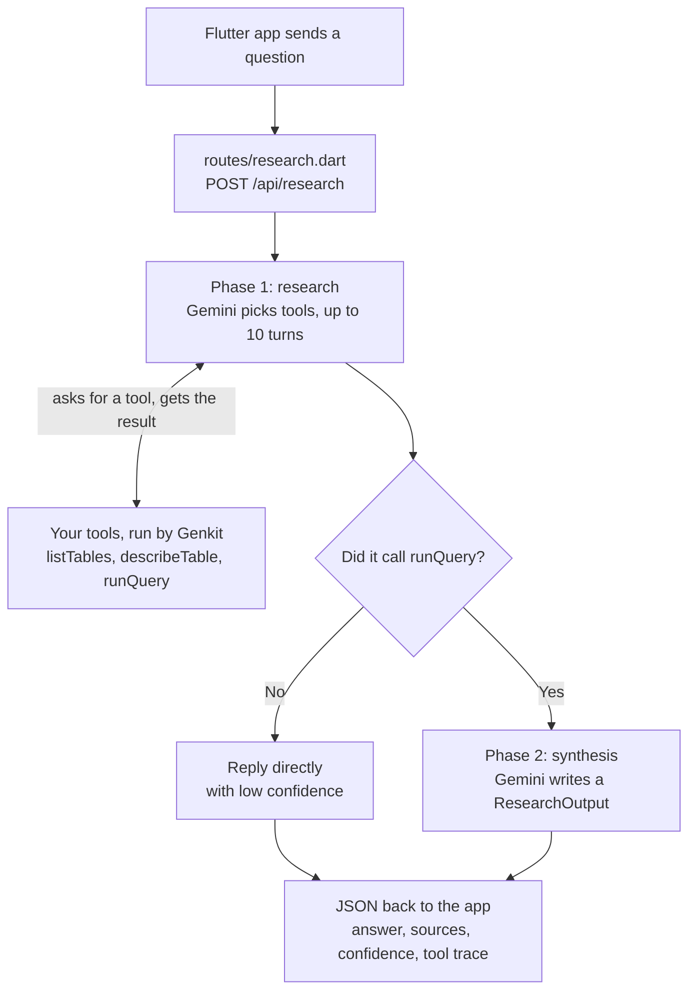

# Build Your First AI Agent with Genkit

In this codelab, you'll build your first AI agent with Genkit and Dart. Ask it a question about a store's database, and it works out the answer itself: it decides which tables to look at, writes its own SQL, and explains what it found, with the queries to prove it.

That is what makes it an **agent** rather than a chatbot. A chatbot answers from what it already knows. An agent takes actions, here calling tools that read the database, then looks at each result and decides what to do next, until it has an answer.

[Genkit](https://genkit.dev/) is Google's open-source framework for AI apps. It sends your prompts to a model such as Gemini and runs the tools the model asks for.

**What you'll learn:**

- Defining typed schemas with Schemantic for tool inputs and structured output
- Creating Genkit tools with `ai.defineTool()`
- Building an agentic flow with a tool-calling loop and `maxTurns`
- Splitting the work into two model calls: one that uses tools, one that returns structured output
- Making the agent admit when it can't answer, instead of inventing one
- Wiring everything together with constructor dependency injection

**Time:** 45 to 60 minutes

**Prerequisites:**

- [Flutter SDK](https://docs.flutter.dev/get-started/install) with Dart 3.12 or later (check with `flutter --version`)
- A Google AI API key ([get one free](https://aistudio.google.com/apikey))
- An iOS Simulator (Xcode) or Android emulator (Android Studio) to run the Flutter app

---

## Step 0: Get the Starter Project

```sh
git clone https://github.com/developerjamiu/music-store-agent.git
cd music-store-agent
git checkout starter
flutter pub get
```

### Explore what you have

The starter has a **complete Flutter app** and a **Dart server** that returns placeholder data. You'll replace the placeholder with an AI agent.

The server uses [Relic](https://docs.dartrelic.dev/), a Dart HTTP framework. Two files in `packages/dart_server/lib/src` are pre-built and stay as they are: `middleware/cors.dart` lets browsers call the API, and `utils/request_helpers.dart` reads and writes JSON and turns Genkit errors into HTTP errors.

**Browse the database:**

Optional: open `packages/dart_server/data/music_store.db` in VS Code with the [SQLite Viewer](https://marketplace.visualstudio.com/items?itemName=qwtel.sqlite-viewer) extension. You'll see 9 tables: artists, albums, tracks, genres, customers, invoices, invoice_lines, playlists, and playlist_tracks.

**Run the starter server:**

```sh
dart run packages/dart_server/bin/server.dart
```

It listens on port 8080, where the Flutter app expects it. Leave it running and open a second terminal for the next command.

**Test it with curl:**

```sh
curl -s http://localhost:8080/api/research \
  -H 'Content-Type: application/json' \
  -d '{"question":"What artists are in the database?"}'
```

You'll see this JSON (formatted here for easier reading):

```json
{
  "answer": "This is a placeholder. Complete the codelab to power this with a real AI agent that explores the music store database!",
  "sources": [],
  "confidence": "low",
  "toolCalls": []
}
```

**Run the Flutter app.** Start an iOS Simulator or Android emulator first, then in another terminal run:

```sh
cd packages/client
flutter run
```

Type a question and tap the send arrow. You'll see the same placeholder. By the end of this codelab, the same screen will show real answers, the SQL queries behind them, and the agent trace.

---

## How the Agent Works

When a user asks _"Who is the top spending customer and what did they buy?"_, the agent doesn't know the answer, and it doesn't know the database schema either. It has to figure out both on its own.

To do this, it uses three tools. A tool is a Dart function plus a name, a description and an input schema, which the model reads to pick a tool. The model can't run code: it asks for a tool by name, with arguments, and Genkit runs your function and sends back the result.

| Tool            | What it does                                          | Input      | Output              |
| --------------- | ----------------------------------------------------- | ---------- | ------------------- |
| `listTables`    | Discovers what tables exist in the database           | None       | List of table names |
| `describeTable` | Shows the columns, types, and foreign keys of a table | Table name | Column definitions  |
| `runQuery`      | Executes a read-only SQL SELECT query                 | SQL string | Up to 50 JSON rows  |

The agent decides which tool to call, in what order, and when to stop. For this question, a typical run looks like this:

1. Agent calls `listTables`: sees `customers`, `invoices`, `invoice_lines`, `tracks` and more
2. Agent calls `describeTable("customers")`: learns the column names and types
3. Agent calls `describeTable("invoices")`: sees the `CustomerId` foreign key, so it knows how to join
4. Agent calls `describeTable("invoice_lines")`: sees how individual purchases connect
5. Agent calls `describeTable("tracks")`: finds where the track names live
6. Agent calls `runQuery("SELECT ... JOIN ... GROUP BY ... ORDER BY ... LIMIT 1")`: finds the top spender
7. Agent calls `runQuery("SELECT ... WHERE CustomerId = ...")`: finds what they bought
8. Agent decides it has enough and stops

The model (Gemini) chooses every step. Your code only provides the tools.

After the loop, a second model call turns the query results into a structured answer with the text, the SQL behind it and a confidence level. If no query ran, for example for a weather question, the agent skips that call and replies with low confidence.

What happens when the app sends a question (errors left out):



Before any question arrives, `bin/server.dart` starts the server. It opens the database, creates Genkit and uses `agent/setup.dart` to build the tools and the agent once.

You'll build it bottom-up: schemas, tools, message helpers, the agent, then the wiring.

---

## Step 1: Define the Schemas

A schema defines the shape of some data, such as what a tool accepts or what the agent returns.

In this step you'll:

1. **Create five schema files.** Each is an abstract class whose name starts with `$`, like `$TableNameInput`. Gemini reads every `description`, so write each one as an instruction that says what the field means. When one schema uses another, refer to it by its `$` name, like `List<$ToolCall>`.
2. **Run `build_runner`.** [Schemantic](https://pub.dev/packages/schemantic), a code generator, turns each `$` class into a real class (`TableNameInput`) in a `.g.dart` file, with `fromJson`, `toJson` and the `$schema` that Genkit sends to the model.

### Tool input schemas

Create `packages/dart_server/lib/src/schemas/table_name_input.dart`, the input for `describeTable` (the table to look at):

```dart
import 'package:schemantic/schemantic.dart';

part 'table_name_input.g.dart';

@Schema(description: 'Which table to look at')
abstract class $TableNameInput {
  @StringField(description: 'The name of the table, as returned by listTables.')
  String get table;
}
```

Create `packages/dart_server/lib/src/schemas/sql_query_input.dart`, the input for `runQuery` (the SQL to run):

```dart
import 'package:schemantic/schemantic.dart';

part 'sql_query_input.g.dart';

@Schema(description: 'The SQL query to run')
abstract class $SqlQueryInput {
  @StringField(
    description:
        'A read-only SQL SELECT statement. No INSERT, UPDATE, DELETE, '
        'or DDL statements are allowed.',
  )
  String get sql;
}
```

### Agent output schemas

Create `packages/dart_server/lib/src/schemas/tool_call.dart`, which records one tool the agent called and what it sent. The app lists these so you can watch the agent work:

```dart
import 'package:schemantic/schemantic.dart';

part 'tool_call.g.dart';

@Schema(description: 'A tool the agent called')
abstract class $ToolCall {
  @StringField(description: 'The name of the tool')
  String get tool;

  @StringField(description: 'What the agent sent to the tool, as JSON text')
  String get input;
}
```

Create `packages/dart_server/lib/src/schemas/research_output.dart`, the answer Gemini writes from the query results:

```dart
import 'package:schemantic/schemantic.dart';

part 'research_output.g.dart';

@Schema(description: 'The answer Gemini writes from the query results')
abstract class $ResearchOutput {
  @StringField(description: 'The answer to the question')
  String get answer;

  @Field(description: 'SQL queries used to produce the answer')
  List<String> get sources;

  @StringField(
    description: 'How confident the agent is in the answer',
    enumValues: ['low', 'medium', 'high'],
  )
  String get confidence;
}
```

Create `packages/dart_server/lib/src/schemas/research_result.dart`, what the server sends back to the app (the answer plus the tools the agent called):

```dart
import 'package:schemantic/schemantic.dart';

import 'tool_call.dart';

part 'research_result.g.dart';

@Schema(description: 'The answer the server sends back to the app')
abstract class $ResearchResult {
  @StringField(description: 'The answer to the question')
  String get answer;

  @Field(description: 'SQL queries used to produce the answer')
  List<String> get sources;

  @StringField(
    description: 'How confident the agent is in the answer',
    enumValues: ['low', 'medium', 'high'],
  )
  String get confidence;

  @Field(description: 'The tools the agent called, in order')
  List<$ToolCall> get toolCalls;
}
```

### Generate the code

Run the generator from the server package (`schemantic_builder` is already a dev dependency):

```sh
cd packages/dart_server
dart run build_runner build
```

**Verify:** `ls lib/src/schemas` shows five `.g.dart` files, and `dart analyze` prints `No issues found!`. If it reports a URI "hasn't been generated", rerun build_runner.

---

## Step 2: Build the Database Tools

Create the three tools below. Each is a class with three parts:

- A constructor that receives `ai` and `db`
- `call()`, which registers the tool with Genkit
- A plain method (`list`, `describe`, `query`) that holds the logic

### ListTablesTool

Create `packages/dart_server/lib/src/tools/list_tables.dart`, which lets the agent discover the tables:

````dart
import 'package:genkit/genkit.dart';
import 'package:schemantic/schemantic.dart';
import 'package:sqlite3/sqlite3.dart';

/// Genkit tool that lists all tables in the database.
///
/// Typically the first tool the agent calls to discover what data is available.
class ListTablesTool {
  final Genkit _ai;
  final Database _db;

  ListTablesTool({required this._ai, required this._db});

  Tool<void, String> call() {
    return _ai.defineTool(
      name: 'listTables',
      description:
          'List all tables in the database. Call this first to discover '
          'what data is available before writing any queries.',
      inputSchema: SchemanticType.voidSchema(),
      outputSchema: SchemanticType.string(),
      fn: (_, _) async => .response(await list()),
    );
  }

  /// Queries `sqlite_master` and returns a formatted list of table names.
  ///
  /// ```
  /// Tables in the database:
  /// - albums
  /// - artists
  /// - tracks
  /// ```
  Future<String> list() async {
    final result = _db.select(
      "SELECT name FROM sqlite_master WHERE type='table' ORDER BY name",
    );

    if (result.isEmpty) return 'The database has no tables.';

    final tables = result.map((row) => row['name'] as String).toList();
    return 'Tables in the database:\n${tables.map((t) => '- $t').join('\n')}';
  }
}
````

> Notice: a Genkit tool returns its result wrapped in `.response(...)` (short for `ToolResult.response(...)`). Any tool you add later needs the same.

### DescribeTableTool

Create `packages/dart_server/lib/src/tools/describe_table.dart`, which shows the agent a table's columns and foreign keys:

````dart
import 'package:genkit/genkit.dart';
import 'package:schemantic/schemantic.dart';
import 'package:sqlite3/sqlite3.dart';

import '../schemas/table_name_input.dart';

/// Genkit tool that describes the columns and foreign keys of a table.
///
/// The agent calls this after [ListTablesTool] to understand a table's
/// schema before writing SQL queries.
///
/// The table name is validated against `sqlite_master` before being used
/// in PRAGMA statements to prevent SQL injection.
class DescribeTableTool {
  final Genkit _ai;
  final Database _db;

  DescribeTableTool({required this._ai, required this._db});

  Tool<TableNameInput, String> call() {
    return _ai.defineTool(
      name: 'describeTable',
      description:
          'Show the columns, types, and constraints of a table. Call this '
          'to understand the schema before writing a query.',
      inputSchema: TableNameInput.$schema,
      outputSchema: SchemanticType.string(),
      fn: (input, _) async => .response(await describe(input)),
    );
  }

  /// Returns column info and foreign keys, or a not-found message.
  ///
  /// ```
  /// Columns in "tracks":
  /// - TrackId INTEGER NOT NULL PRIMARY KEY
  /// - Name TEXT NOT NULL
  /// - AlbumId INTEGER
  /// Foreign keys:
  /// - AlbumId -> albums(AlbumId)
  /// ```
  Future<String> describe(TableNameInput input) async {
    final tableName = input.table;

    final exists = _db.select(
      "SELECT 1 FROM sqlite_master WHERE type='table' AND name=?",
      [tableName],
    );
    if (exists.isEmpty) {
      return 'Table "$tableName" does not exist.';
    }

    final columns = _db.select('PRAGMA table_info("$tableName")');

    final buffer = StringBuffer('Columns in "$tableName":')..writeln();
    for (final col in columns) {
      final name = col['name'] as String;
      final type = col['type'] as String;
      final notNull = col['notnull'] == 1 ? ' NOT NULL' : '';
      final pk = col['pk'] == 1 ? ' PRIMARY KEY' : '';
      buffer.writeln('- $name $type$notNull$pk');
    }

    final fks = _db.select('PRAGMA foreign_key_list("$tableName")');
    if (fks.isNotEmpty) {
      buffer.writeln('Foreign keys:');
      for (final fk in fks) {
        buffer.writeln('- ${fk['from']} -> ${fk['table']}(${fk['to']})');
      }
    }

    return buffer.toString().trim();
  }
}
````

### RunQueryTool

Create `packages/dart_server/lib/src/tools/run_query.dart`, which runs a read-only `SELECT` and returns up to 50 rows as JSON:

````dart
import 'dart:convert';

import 'package:genkit/genkit.dart';
import 'package:schemantic/schemantic.dart';
import 'package:sqlite3/sqlite3.dart';

import '../schemas/sql_query_input.dart';

/// Genkit tool that executes a read-only SQL query against the database.
///
/// Only `SELECT` statements are allowed. Results are capped at [_maxRows]
/// rows and returned as JSON. SQL errors are returned as tool output
/// (not thrown) so the agent can see the error and adjust its query.
class RunQueryTool {
  static const _maxRows = 50;

  final Genkit _ai;
  final Database _db;

  RunQueryTool({required this._ai, required this._db});

  Tool<SqlQueryInput, String> call() {
    return _ai.defineTool(
      name: 'runQuery',
      description:
          'Execute a read-only SQL SELECT query and return the rows '
          'as JSON. Returns up to $_maxRows rows. Only '
          'SELECT statements are allowed.',
      inputSchema: SqlQueryInput.$schema,
      outputSchema: SchemanticType.string(),
      fn: (input, _) async => .response(await query(input)),
    );
  }

  /// Executes the query and returns JSON rows, or an error message.
  ///
  /// ```
  /// [{"Name":"AC/DC"},{"Name":"Led Zeppelin"},{"Name":"Queen"}]
  /// ```
  Future<String> query(SqlQueryInput input) async {
    final sql = input.sql.trim();
    if (!sql.toUpperCase().startsWith('SELECT')) {
      return 'Only SELECT queries are allowed. '
          'Received: ${sql.split(' ').first}';
    }

    try {
      final result = _db.select(sql);

      if (result.isEmpty) return 'Query returned 0 rows.';

      final columns = result.first.keys.toList();
      final rows = result.take(_maxRows).map((row) {
        return {for (final col in columns) col: row[col]};
      }).toList();

      final truncated = result.length > _maxRows
          ? '\n(showing $_maxRows of ${result.length} rows)'
          : '';

      return '${jsonEncode(rows)}$truncated';
    } on SqliteException catch (e) {
      return 'SQL error: ${e.message}';
    }
  }
}
````

`query` returns SQL errors as text instead of throwing, so the model can read it and fix its SQL.

**Verify:** `dart analyze` prints `No issues found!`

---

## Step 3: Build the Message Helpers

While the agent works, Genkit records everything in a conversation: the question, each tool the model asks for, and each result your tools return. The agent you build in Step 4 needs two things from that conversation, so you'll write a helper for each.

Create `packages/dart_server/lib/src/utils/message_helpers.dart`:

````dart
import 'dart:convert';

import 'package:genkit/genkit.dart';

import '../schemas/tool_call.dart';

/// Lists every tool the model asked for, in order, for the app's trace.
///
/// ```
/// [ToolCall(tool: "listTables", input: "{}"),
///  ToolCall(tool: "describeTable", input: "{\"table\":\"artists\"}"),
///  ToolCall(tool: "runQuery", input: "{\"sql\":\"SELECT Name FROM artists\"}")]
/// ```
List<ToolCall> extractToolCalls(List<Message> messages) {
  final calls = <ToolCall>[];
  for (final message in messages) {
    for (final part in message.content) {
      final toolRequestPart = part.toolRequestPart;
      if (toolRequestPart == null) continue;
      final request = toolRequestPart.toolRequest;
      final input = request.input;
      calls.add(
        ToolCall(
          tool: request.name,
          // A tool with no input can arrive as null or "NULL": record "{}".
          input: jsonEncode(input is Map ? input : const <String, dynamic>{}),
        ),
      );
    }
  }
  return calls;
}

/// Builds the notes Phase 2 turns into an answer.
///
/// Keeps only `runQuery` results, each under the SQL that produced it,
/// then adds the model's own summary.
///
/// ```
/// [Query: SELECT Name FROM artists LIMIT 3]
/// [{"Name":"AC/DC"},{"Name":"Led Zeppelin"},{"Name":"Queen"}]
///
/// [Agent summary]
/// The database contains 15 artists.
/// ```
String buildResearchNotes(GenerateResult response) {
  final buffer = StringBuffer();

  for (final message in response.messages) {
    if (message.role == Role.tool) {
      for (final part in message.content) {
        final toolResponsePart = part.toolResponsePart;
        if (toolResponsePart == null) continue;
        final toolResponse = toolResponsePart.toolResponse;
        if (toolResponse.name != 'runQuery') continue;
        final output = toolResponse.output;
        if (output == null) continue;

        final sql = _findQueryForResponse(response.messages, toolResponse);
        if (sql != null) buffer.writeln('[Query: $sql]');
        buffer.writeln(output is String ? output : jsonEncode(output));
        buffer.writeln();
      }
    }
  }

  final modelSummary = response.text;
  if (modelSummary.isNotEmpty) {
    buffer.writeln('[Agent summary]');
    buffer.writeln(modelSummary);
  }

  final result = buffer.toString();
  if (result.trim().isEmpty) {
    return 'No query results were produced during research.';
  }
  return result;
}

String? _findQueryForResponse(
  List<Message> messages,
  ToolResponse toolResponse,
) {
  for (final message in messages) {
    for (final part in message.content) {
      final request = part.toolRequestPart;
      if (request == null) continue;
      if (request.toolRequest.ref == toolResponse.ref &&
          request.toolRequest.name == 'runQuery') {
        if (request.toolRequest.input case {'sql': final String sql}) {
          return sql;
        }
        return null;
      }
    }
  }
  return null;
}
````

What each function does:

- `extractToolCalls` lists the tools the model called. The app shows them as the agent trace.
- `buildResearchNotes` collects the query results, each with its SQL. Step 4 uses them to write the answer.
- `_findQueryForResponse` helps `buildResearchNotes` find the SQL for each result.

**Verify:** `dart analyze` prints `No issues found!`

---

## Step 4: Build the Research Agent

Now put the pieces together. The agent uses your tools to research a question (Phase 1), then writes the answer from the notes your helpers build (Phase 2).

Create `packages/dart_server/lib/src/agent/research_agent.dart`:

```dart
import 'package:genkit/genkit.dart';
import 'package:genkit_google_genai/genkit_google_genai.dart';
import 'package:schemantic/schemantic.dart';

import '../schemas/research_output.dart';
import '../schemas/research_result.dart';
import '../schemas/sql_query_input.dart';
import '../schemas/table_name_input.dart';
import '../utils/message_helpers.dart';

class ResearchAgent {
  static const _researchPrompt =
      'You are a database analyst agent. You can ONLY answer questions '
      'by querying the music store database. Never use your own knowledge. '
      'You do NOT know the database schema, so you must discover it using '
      'the tools provided:\n'
      '- listTables: discover what tables exist\n'
      '- describeTable: see the columns and foreign keys of a table\n'
      '- runQuery: execute a read-only SQL SELECT query\n\n'
      'Strategy:\n'
      '1. Use listTables to discover what tables exist.\n'
      '2. Call describeTable on relevant tables to understand columns and joins.\n'
      '3. Write and run SQL queries to find the answer.\n'
      '4. If a query returns unexpected results, try a different approach.\n'
      '5. If the question cannot be answered with the available data, say so.\n\n'
      'NEVER answer from your own knowledge. All answers must come from query results.';

  static const _maxTurns = 10;

  static const _outOfTurnsAnswer =
      "I couldn't finish researching this question within the allowed "
      'steps. Try asking something more specific.';

  static const _synthesisPrompt =
      'You are a database analyst. Using ONLY the research notes below, '
      'produce a structured answer to the user\'s question.\n\n'
      'Rules:\n'
      '- Set confidence to "high" if the query results clearly answer the '
      'question, "medium" if partially, "low" if the data was not found.\n'
      '- In the sources array, include the SQL queries from the notes '
      'that produced the key results (the SELECT statements).\n'
      '- Write a clear, natural-language answer that interprets the data.\n'
      '- When listing items such as tracks, name each distinct item once and '
      'give a count when it appears more than once.';

  final Genkit _ai;
  final ModelRef<GeminiOptions> _model;
  final Tool<void, String> _listTablesTool;
  final Tool<TableNameInput, String> _describeTableTool;
  final Tool<SqlQueryInput, String> _runQueryTool;

  ResearchAgent({
    required this._ai,
    ModelRef<GeminiOptions>? model,
    required this._listTablesTool,
    required this._describeTableTool,
    required this._runQueryTool,
  }) : _model = model ?? googleAI.gemini('gemini-3.5-flash-lite');

  Flow<String, ResearchResult, Never, Never> call() {
    return _ai.defineFlow(
      name: 'researchFlow',
      inputSchema: SchemanticType.string(),
      outputSchema: ResearchResult.$schema,
      fn: (input, _) => research(input),
    );
  }

  Future<ResearchResult> research(String question) async {
    final research = await _runResearchPhase(question);
    final toolCalls = extractToolCalls(research.messages);

    // No query ran, so nothing came from the database: answer with low
    // confidence. That covers out-of-scope questions and an agent that ran
    // out of turns before querying.
    if (!toolCalls.any((call) => call.tool == 'runQuery')) {
      return ResearchResult(
        answer: research.text.isNotEmpty ? research.text : _outOfTurnsAnswer,
        sources: const [],
        confidence: 'low',
        toolCalls: toolCalls,
      );
    }

    final notes = buildResearchNotes(research);
    final synthesis = await _runSynthesisPhase(question, notes);
    return ResearchResult(
      answer: synthesis.answer,
      sources: synthesis.sources,
      confidence: synthesis.confidence,
      toolCalls: toolCalls,
    );
  }

  /// Phase 1: the model calls tools until it can answer, up to
  /// [_maxTurns] times. Hitting the limit doesn't throw. Genkit returns
  /// everything that happened so far.
  Future<GenerateResult> _runResearchPhase(String question) async {
    final response = await _ai.generate(
      model: _model,
      system: _researchPrompt,
      prompt: question,
      tools: [_listTablesTool, _describeTableTool, _runQueryTool],
      maxTurns: _maxTurns,
    );
    _throwIfFailed(response);
    return response;
  }

  Future<ResearchOutput> _runSynthesisPhase(
    String question,
    String notes,
  ) async {
    final response = await _ai.generate(
      model: _model,
      system: _synthesisPrompt,
      prompt: 'Question: $question\n\nResearch notes:\n$notes',
      outputSchema: ResearchOutput.$schema,
    );
    _throwIfFailed(response);

    // A reply that does not match the schema comes back as an error on the
    // result instead of a throw. Fail here so the route answers 500.
    final output = response.output;
    if (output == null) {
      throw GenkitException(
        response.error?.message ?? 'The model returned no structured answer.',
        cause: response.cause,
      );
    }
    return output;
  }

  /// Throws if the model call failed.
  ///
  /// Genkit 1.0 reports failures in the result instead of throwing, so this
  /// turns them back into an error the route can send as an HTTP error.
  static void _throwIfFailed(GenerateResult response) {
    if (response.finishReason != FinishReason.failed) return;

    final cause = response.cause;
    if (cause is GenkitException) throw cause;
    throw GenkitException(
      response.error?.message ?? 'Generation failed.',
      cause: cause,
    );
  }
}
```

How it works:

- **The prompt:** `_researchPrompt` tells the model it doesn't know the database and must answer only from query results. That is what makes it explore.
- **Phase 1:** `_runResearchPhase` makes one `generate` call with your three tools. Gemini keeps calling tools until it can answer, up to 10 times.
- **No query, no Phase 2:** if the model never called `runQuery`, nothing came from the database. The agent returns the model's reply with `low` confidence, which is how a weather question gets a polite refusal.
- **Phase 2:** `_runSynthesisPhase` sends the notes to Gemini with `outputSchema`, so the answer comes back as a `ResearchOutput`.
- **Errors:** `_throwIfFailed` turns a failed model call into an error, which the route sends back as an HTTP error in Step 6.

`call()` wraps `research` in a Genkit flow, the function the route will run.

> **Why two calls?** Gemini can combine tools and a fixed answer format only as a preview feature. When we tried it, the model kept calling tools and never answered.

**Verify:** `dart analyze` prints `No issues found!`

---

## Step 5: Wire Everything in the Composition Root

Each class you wrote gets what it needs (`ai`, `db`, the tools) through its constructor instead of creating it. This is dependency injection. `AISetup` is the one place that creates those objects and passes them in, which is called the composition root.

Create `packages/dart_server/lib/src/agent/setup.dart`:

```dart
import 'package:genkit/genkit.dart';
import 'package:sqlite3/sqlite3.dart';

import '../schemas/research_result.dart';
import '../tools/describe_table.dart';
import '../tools/list_tables.dart';
import '../tools/run_query.dart';
import 'research_agent.dart';

class AISetup {
  final Genkit _ai;
  final Database _db;

  AISetup({required this._ai, required this._db});

  Flow<String, ResearchResult, Never, Never> call() {
    final listTablesTool = ListTablesTool(ai: _ai, db: _db);
    final describeTableTool = DescribeTableTool(ai: _ai, db: _db);
    final runQueryTool = RunQueryTool(ai: _ai, db: _db);

    return ResearchAgent(
      ai: _ai,
      listTablesTool: listTablesTool(),
      describeTableTool: describeTableTool(),
      runQueryTool: runQueryTool(),
    )();
  }
}
```

> Notice: an object with a `call()` method runs like a function, so `listTablesTool()` registers the tool and returns its `Tool`. `ResearchAgent(...)()` returns the flow.

**Verify:** `dart analyze` prints `No issues found!`

---

## Step 6: Connect the Agent to the Route

Now the route runs the agent instead of returning the placeholder. It gets the flow through its constructor, like the tools in Step 2. Replace the contents of `packages/dart_server/lib/src/routes/research.dart` with:

```dart
import 'package:genkit/genkit.dart';
import 'package:relic/relic.dart';

import '../schemas/research_result.dart';
import '../utils/request_helpers.dart';

typedef ResearchFlow = Flow<String, ResearchResult, Never, Never>;

class ResearchRoutes {
  final ResearchFlow _researchFlow;

  ResearchRoutes({required this._researchFlow});

  RelicRouter get router {
    final router = RelicRouter();
    router.post('/api/research', _research);
    return router;
  }

  Future<Response> _research(Request request) async {
    final body = await parseJsonBody(request);
    if (body == null) return errorResponse(400, 'Invalid JSON body');

    final question = body['question'];
    if (question is! String || question.trim().isEmpty) {
      return errorResponse(400, 'question is required');
    }

    try {
      final result = await _researchFlow(question);
      return jsonResponse(result.toJson());
    } on GenkitException catch (e) {
      return handleGenkitError(e);
    } catch (e) {
      print('Unexpected error: $e');
      return errorResponse(500, 'Agent failed. Check server logs for details.');
    }
  }
}
```

The router and the request validation are unchanged. What's new:

- `_researchFlow(question)` runs the agent, and `result.toJson()` turns the `ResearchResult` into the JSON the app reads.
- `handleGenkitError`, pre-built in `request_helpers.dart`, maps the `status` of a `GenkitException` to an HTTP status: `resourceExhausted` (your API quota ran out) becomes 429, `unavailable` (the model is overloaded) becomes 503, and anything else becomes 500.

Until you update the entrypoint in Step 7, `dart analyze` reports one error in `bin/server.dart`: "The named parameter 'researchFlow' is required". That is expected.

---

## Step 7: Update the Server Entrypoint

Last, the entrypoint builds the real objects once, at startup, and hands the flow to the route. Replace `packages/dart_server/bin/server.dart` with:

```dart
import 'dart:io';

import 'package:genkit/genkit.dart';
import 'package:genkit_google_genai/genkit_google_genai.dart';
import 'package:relic/relic.dart';
import 'package:sqlite3/sqlite3.dart';

import 'package:dart_server/src/agent/setup.dart';
import 'package:dart_server/src/middleware/cors.dart';
import 'package:dart_server/src/routes/research.dart';

Future<void> main() async {
  final dbPath = Platform.script.resolve('../data/music_store.db').toFilePath();
  if (!File(dbPath).existsSync()) {
    stderr.writeln('Database not found at $dbPath.');
    exit(1);
  }

  final ai = Genkit(plugins: [googleAI()]);
  final researchFlow = AISetup(ai: ai, db: sqlite3.open(dbPath))();
  final routes = ResearchRoutes(researchFlow: researchFlow);

  // Mounted for every path so cors() also reaches preflights and 404/405s.
  final app = RelicApp()
    ..use('/', cors())
    ..use('/', logRequests())
    ..any('/**', routes.router.asHandler);

  final port = int.parse(Platform.environment['PORT'] ?? '8080');
  final server = await app.serve(address: InternetAddress.anyIPv4, port: port);

  print('Server running on http://localhost:${server.port}');
}
```

Everything above the `RelicApp` setup is new. It checks that the database file exists, creates Genkit with the Google AI plugin, opens the database, builds the research flow you wired in Step 5 and passes it to `ResearchRoutes`. `googleAI()` reads your key from `GOOGLE_API_KEY`.

**Test it live** from the repository root. First stop the starter server from Step 0 (Ctrl+C in its terminal), because it still holds port 8080. If your shell is still in `packages/dart_server` from Step 1, run `cd ../..`.

```sh
export GOOGLE_API_KEY=your-key-here
dart run packages/dart_server/bin/server.dart
```

```sh
curl -s http://localhost:8080/api/research \
  -H 'Content-Type: application/json' \
  -d '{"question":"Which genre has the most tracks?"}'
```

You should see an answer naming Rock (31 tracks), the SQL behind it in `sources`, and `toolCalls` showing the agent's exploration sequence. The wording varies by run. Open the Flutter app and try it there too: the placeholder is gone.

If curl prints `Agent failed. Check server logs for details.` and the server log says `apiKey must be set to an API key`, the server can't see your key. Export it in the server's terminal and restart.

---

## You're Done

You now have a working agent that answers from real query results.

### What you built

| Component            | What it does                                                    |
| -------------------- | --------------------------------------------------------------- |
| **5 schemas**        | Define typed data shapes for tool inputs and agent output       |
| **3 tools**          | Explore a database: list tables, describe schema, run queries   |
| **Message helpers**  | Extract tool calls and build research notes from conversations  |
| **Research agent**   | Two phases: a tool loop, then a structured answer               |
| **Composition root** | Wire all dependencies together                                  |
| **Route handler**    | Connect the agent flow to the HTTP endpoint                     |

### Try these questions

```sh
# Simple lookup
curl -s http://localhost:8080/api/research \
  -H 'Content-Type: application/json' \
  -d '{"question":"What artists are in the database?"}'

# Multi-table JOINs
curl -s http://localhost:8080/api/research \
  -H 'Content-Type: application/json' \
  -d '{"question":"Who is the top spending customer and what did they buy?"}'

# Many-to-many relationship
curl -s http://localhost:8080/api/research \
  -H 'Content-Type: application/json' \
  -d '{"question":"What songs are in the Chill Jazz playlist?"}'

# Out of scope: the agent should refuse politely
curl -s http://localhost:8080/api/research \
  -H 'Content-Type: application/json' \
  -d '{"question":"What is the weather today?"}'
```

### What's Next

- **Add more tools**: a `sampleRows` tool that returns a few rows from any table
- **Add tests**: use `ai.defineModel()` to create fake models that simulate the tool-calling loop without API calls (see the `main` branch for examples)
- **Add streaming**: stream tool activity to the UI in real time with server-sent events (SSE)
- **Try a different database**: swap `music_store.db` for your own data
