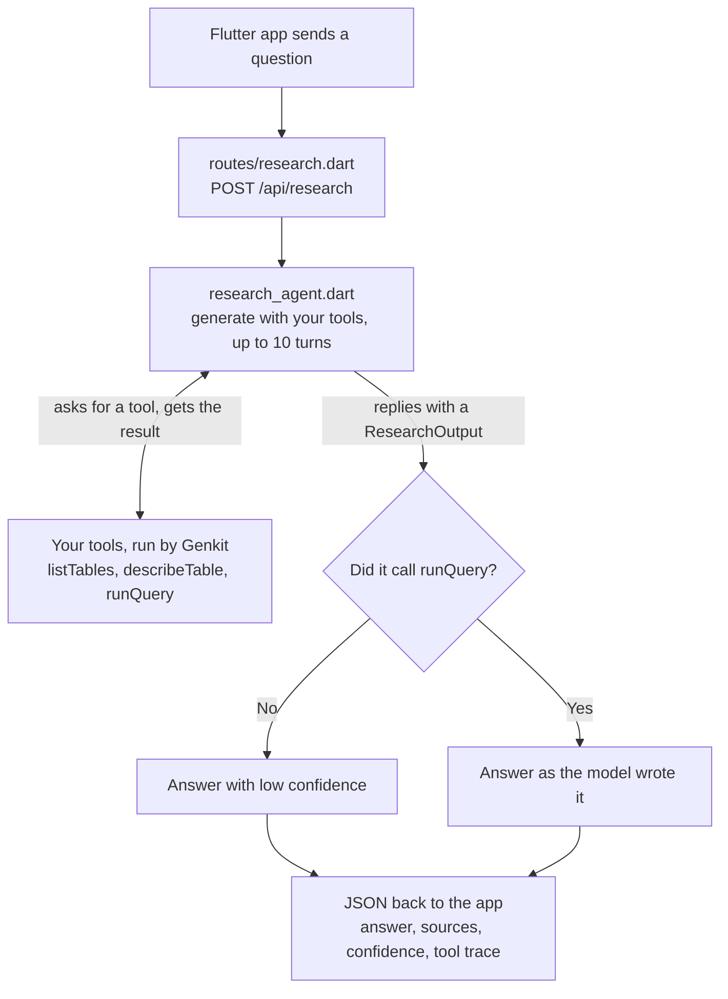

# Build Your First AI Agent with Genkit

In this codelab, you'll build your first AI agent with Genkit and Dart. Ask it a question about a store's database, and it works out the answer itself: it decides which tables to look at, writes its own SQL, and explains what it found, with the queries to prove it.

That is what makes it an **agent** rather than a chatbot. A chatbot answers from what it already knows. An agent takes actions, here calling tools that read the database, then looks at each result and decides what to do next, until it has an answer.

[Genkit](https://genkit.dev/) is Google's open-source framework for AI apps. It sends your prompts to a model such as Gemini and runs the tools the model asks for.

**What you'll learn:**

- Defining typed schemas with Schemantic for tool inputs and structured output
- Creating Genkit tools with `ai.defineTool()`
- Building an agentic flow with a tool-calling loop and `maxTurns`
- Getting a structured JSON answer from a model that uses tools
- Making the agent admit when it can't answer, instead of inventing one

**Time:** 45 to 60 minutes

**Prerequisites:**

- [Flutter SDK](https://docs.flutter.dev/get-started/install) with Dart 3.12 or later (check with `flutter --version`)
- A Google AI API key ([get one free](https://aistudio.google.com/apikey))
- An iOS Simulator (Xcode) or Android emulator (Android Studio) to run the Flutter app
- A code editor, such as [VS Code](https://code.visualstudio.com/) with the Dart and Flutter extensions

---

## Step 0: Get the Starter Project

```sh
git clone https://github.com/developerjamiu/bookstore-agent.git
cd bookstore-agent
git checkout starter
flutter pub get
```

Open the `bookstore-agent` folder in your editor. In VS Code, either:

- use **File > Open Folder**, or
- run `code .` from the same terminal.

### Explore what you have

The starter has a **complete Flutter app** and a **Dart server** that returns placeholder data. You'll replace the placeholder with an AI agent.

The server uses [Relic](https://docs.dartrelic.dev/), a high-performance, type-safe Dart web server built by the Serverpod team. Two files in `packages/dart_server/lib/src` are pre-built and stay as they are: `middleware/cors.dart` lets browsers call the API, and `utils/request_helpers.dart` reads and writes JSON and turns Genkit errors into HTTP errors.

**Browse the database:**

Optional: open `packages/dart_server/data/bookstore.db` in VS Code with the [SQLite Viewer](https://marketplace.visualstudio.com/items?itemName=qwtel.sqlite-viewer) extension. You'll see 9 tables: authors, publishers, books, genres, customers, orders, order_items, reading_lists, and reading_list_books.

**Run the starter server:**

```sh
dart run packages/dart_server/bin/server.dart
```

It listens on port 8080, where the Flutter app expects it. Leave it running and open a second terminal for the next command.

**Test it with curl:**

```sh
curl -s http://localhost:8080/api/research \
  -H 'Content-Type: application/json' \
  -d '{"question":"What authors are in the database?"}'
```

You'll see this JSON (formatted here for easier reading):

```json
{
  "answer": "This is a placeholder. Complete the codelab to power this with a real AI agent that explores the bookstore database!",
  "sources": [],
  "confidence": "low",
  "toolCalls": []
}
```

**Run the Flutter app.** Start an iOS Simulator or Android emulator first, then in another terminal run:

```sh
cd packages/client
flutter run
```

Type a question and tap the send arrow. You'll see the same placeholder. By the end of this codelab, the same screen will show real answers, the SQL queries behind them, and the agent trace.

---

## How the Agent Works

When a user asks _"Who is the top spending customer and what did they buy?"_, the agent doesn't know the answer, and it doesn't know the database schema either. It has to figure out both on its own.

To do this, it uses three tools. A tool is a Dart function plus a name, a description and an input schema, which the model reads to pick a tool. The model can't run code: it asks for a tool by name, with arguments, and Genkit runs your function and sends back the result.

| Tool            | What it does                                          | Input      | Output              |
| --------------- | ----------------------------------------------------- | ---------- | ------------------- |
| `listTables`    | Discovers what tables exist in the database           | None       | List of table names |
| `describeTable` | Shows the columns, types, and foreign keys of a table | Table name | Column definitions  |
| `runQuery`      | Executes a read-only SQL SELECT query                 | SQL string | Up to 50 JSON rows  |

The agent decides which tool to call, in what order, and when to stop. For this question, a typical run looks like this:

1. Agent calls `listTables`: sees `customers`, `orders`, `order_items`, `books` and more
2. Agent calls `describeTable("customers")`: learns the column names and types
3. Agent calls `describeTable("orders")`: sees the `CustomerId` foreign key, so it knows how to join
4. Agent calls `describeTable("order_items")`: sees how individual purchases connect
5. Agent calls `describeTable("books")`: finds where the book titles live
6. Agent calls `runQuery("SELECT ... JOIN ... GROUP BY ... ORDER BY ... LIMIT 1")`: finds the top spender
7. Agent calls `runQuery("SELECT ... WHERE CustomerId = ...")`: finds what they bought
8. Agent decides it has enough and stops

The model (Gemini) chooses every step. Your code only provides the tools.

When it has what it needs, the model replies with a structured answer: the text, the SQL behind it and a confidence level. If no query ran, for example for an off-topic question like "What is the weather today?", the answer gets low confidence.

What happens when the app sends a question (errors left out):



Before any question arrives, `bin/server.dart` starts the server. It opens the database, creates Genkit and uses `agent/setup.dart` to build the tools and the agent once.

You'll build it bottom-up: schemas, tools, a message helper, the agent, then the wiring.

---

## Step 1: Define the Schemas

A schema defines the shape of some data, such as what a tool accepts or what the agent returns.

In this step you'll:

1. **Create five schema files.** Each is an abstract class whose name starts with `$`, like `$TableNameInput`. Gemini reads every `description`, so write each one as an instruction that says what the field means. When one schema uses another, refer to it by its `$` name, like `List<$ToolCall>`.
2. **Run `build_runner`.** [Schemantic](https://pub.dev/packages/schemantic), a code generator, turns each `$` class into a real class (`TableNameInput`) in a `.g.dart` file, with `fromJson`, `toJson` and the `$schema` that Genkit sends to the model.

### Tool input schemas

Create `packages/dart_server/lib/src/schemas/table_name_input.dart`, the input for `describeTable` (the table to look at):

```dart
import 'package:schemantic/schemantic.dart';

part 'table_name_input.g.dart';

@Schema(description: 'Which table to look at')
abstract class $TableNameInput {
  @StringField(description: 'The name of the table, as returned by listTables.')
  String get table;
}
```

Create `packages/dart_server/lib/src/schemas/sql_query_input.dart`, the input for `runQuery` (the SQL to run):

```dart
import 'package:schemantic/schemantic.dart';

part 'sql_query_input.g.dart';

@Schema(description: 'The SQL query to run')
abstract class $SqlQueryInput {
  @StringField(
    description:
        'A read-only SQL SELECT statement. No INSERT, UPDATE, DELETE, '
        'or DDL statements are allowed.',
  )
  String get sql;
}
```

### Agent output schemas

Create `packages/dart_server/lib/src/schemas/tool_call.dart`, which records one tool the agent called and what it sent. The app lists these so you can watch the agent work:

```dart
import 'package:schemantic/schemantic.dart';

part 'tool_call.g.dart';

@Schema(description: 'A tool the agent called')
abstract class $ToolCall {
  @StringField(description: 'The name of the tool')
  String get tool;

  @StringField(description: 'What the agent sent to the tool, as JSON text')
  String get input;
}
```

Create `packages/dart_server/lib/src/schemas/research_output.dart`, the answer Gemini writes from the query results:

```dart
import 'package:schemantic/schemantic.dart';

part 'research_output.g.dart';

@Schema(description: 'The answer Gemini writes from the query results')
abstract class $ResearchOutput {
  @StringField(description: 'The answer to the question')
  String get answer;

  @Field(description: 'SQL queries used to produce the answer')
  List<String> get sources;

  @StringField(
    description: 'How confident the agent is in the answer',
    enumValues: ['low', 'medium', 'high'],
  )
  String get confidence;
}
```

Create `packages/dart_server/lib/src/schemas/research_result.dart`, what the server sends back to the app (the answer plus the tools the agent called):

```dart
import 'package:schemantic/schemantic.dart';

import 'tool_call.dart';

part 'research_result.g.dart';

@Schema(description: 'The answer the server sends back to the app')
abstract class $ResearchResult {
  @StringField(description: 'The answer to the question')
  String get answer;

  @Field(description: 'SQL queries used to produce the answer')
  List<String> get sources;

  @StringField(
    description: 'How confident the agent is in the answer',
    enumValues: ['low', 'medium', 'high'],
  )
  String get confidence;

  @Field(description: 'The tools the agent called, in order')
  List<$ToolCall> get toolCalls;
}
```

### Generate the code

Run the generator from the server package (`schemantic_builder` is already a dev dependency):

```sh
cd packages/dart_server
dart run build_runner build
```

**Verify:** `ls lib/src/schemas` shows five `.g.dart` files, and `dart analyze` prints `No issues found!`. If it reports a URI "hasn't been generated", rerun build_runner.

---

## Step 2: Build the Database Tools

Create the three tools below. Each is a class with three parts:

- A constructor that receives `ai` and `db`
- `define()`, which registers the tool with Genkit
- A plain method (`list`, `describe`, `query`) that holds the logic

### ListTablesTool

Create `packages/dart_server/lib/src/tools/list_tables.dart`, which lets the agent discover the tables:

````dart
import 'package:genkit/genkit.dart';
import 'package:schemantic/schemantic.dart';
import 'package:sqlite3/sqlite3.dart';

/// Genkit tool that lists all tables in the database.
///
/// Typically the first tool the agent calls to discover what data is available.
class ListTablesTool {
  final Genkit _ai;
  final Database _db;

  ListTablesTool({required this._ai, required this._db});

  Tool<void, String> define() {
    return _ai.defineTool(
      name: 'listTables',
      description:
          'List all tables in the database. Call this first to discover '
          'what data is available before writing any queries.',
      inputSchema: SchemanticType.voidSchema(),
      outputSchema: SchemanticType.string(),
      fn: (_, _) async => .response(await list()),
    );
  }

  /// Queries `sqlite_master` and returns a formatted list of table names.
  ///
  /// ```
  /// Tables in the database:
  /// - authors
  /// - books
  /// - customers
  /// ```
  Future<String> list() async {
    final result = _db.select(
      "SELECT name FROM sqlite_master WHERE type='table' ORDER BY name",
    );

    if (result.isEmpty) return 'The database has no tables.';

    final tables = result.map((row) => row['name'] as String).toList();
    return 'Tables in the database:\n${tables.map((t) => '- $t').join('\n')}';
  }
}
````

> Notice: a Genkit tool returns its result wrapped in `.response(...)` (short for `ToolResult.response(...)`). Any tool you add later needs the same.

### DescribeTableTool

Create `packages/dart_server/lib/src/tools/describe_table.dart`, which shows the agent a table's columns and foreign keys:

````dart
import 'package:genkit/genkit.dart';
import 'package:schemantic/schemantic.dart';
import 'package:sqlite3/sqlite3.dart';

import '../schemas/table_name_input.dart';

/// Genkit tool that describes the columns and foreign keys of a table.
///
/// The agent calls this after [ListTablesTool] to understand a table's
/// schema before writing SQL queries.
///
/// The table name is validated against `sqlite_master` before being used
/// in PRAGMA statements to prevent SQL injection.
class DescribeTableTool {
  final Genkit _ai;
  final Database _db;

  DescribeTableTool({required this._ai, required this._db});

  Tool<TableNameInput, String> define() {
    return _ai.defineTool(
      name: 'describeTable',
      description:
          'Show the columns, types, and constraints of a table. Call this '
          'to understand the schema before writing a query.',
      inputSchema: TableNameInput.$schema,
      outputSchema: SchemanticType.string(),
      fn: (input, _) async => .response(await describe(input)),
    );
  }

  /// Returns column info and foreign keys, or a not-found message.
  ///
  /// ```
  /// Columns in "books":
  /// - BookId INTEGER PRIMARY KEY
  /// - Title TEXT NOT NULL
  /// - AuthorId INTEGER NOT NULL
  /// Foreign keys:
  /// - AuthorId -> authors(AuthorId)
  /// ```
  Future<String> describe(TableNameInput input) async {
    final tableName = input.table;

    final exists = _db.select(
      "SELECT 1 FROM sqlite_master WHERE type='table' AND name=?",
      [tableName],
    );
    if (exists.isEmpty) {
      return 'Table "$tableName" does not exist.';
    }

    final columns = _db.select('PRAGMA table_info("$tableName")');

    final buffer = StringBuffer('Columns in "$tableName":')..writeln();
    for (final col in columns) {
      final name = col['name'] as String;
      final type = col['type'] as String;
      final notNull = col['notnull'] == 1 ? ' NOT NULL' : '';
      final pk = col['pk'] == 1 ? ' PRIMARY KEY' : '';
      buffer.writeln('- $name $type$notNull$pk');
    }

    final fks = _db.select('PRAGMA foreign_key_list("$tableName")');
    if (fks.isNotEmpty) {
      buffer.writeln('Foreign keys:');
      for (final fk in fks) {
        buffer.writeln('- ${fk['from']} -> ${fk['table']}(${fk['to']})');
      }
    }

    return buffer.toString().trim();
  }
}
````

### RunQueryTool

Create `packages/dart_server/lib/src/tools/run_query.dart`, which runs a read-only `SELECT` and returns up to 50 rows as JSON:

````dart
import 'dart:convert';

import 'package:genkit/genkit.dart';
import 'package:schemantic/schemantic.dart';
import 'package:sqlite3/sqlite3.dart';

import '../schemas/sql_query_input.dart';

/// Genkit tool that executes a read-only SQL query against the database.
///
/// Only `SELECT` statements are allowed. Results are capped at [_maxRows]
/// rows and returned as JSON. SQL errors are returned as tool output
/// (not thrown) so the agent can see the error and adjust its query.
class RunQueryTool {
  static const _maxRows = 50;

  final Genkit _ai;
  final Database _db;

  RunQueryTool({required this._ai, required this._db});

  Tool<SqlQueryInput, String> define() {
    return _ai.defineTool(
      name: 'runQuery',
      description:
          'Execute a read-only SQL SELECT query and return the rows '
          'as JSON. Returns up to $_maxRows rows. Only '
          'SELECT statements are allowed.',
      inputSchema: SqlQueryInput.$schema,
      outputSchema: SchemanticType.string(),
      fn: (input, _) async => .response(await query(input)),
    );
  }

  /// Executes the query and returns JSON rows, or an error message.
  ///
  /// ```
  /// [{"Name":"Jane Austen"},{"Name":"Charles Dickens"},{"Name":"Mark Twain"}]
  /// ```
  Future<String> query(SqlQueryInput input) async {
    final sql = input.sql.trim();
    if (!sql.toUpperCase().startsWith('SELECT')) {
      return 'Only SELECT queries are allowed. '
          'Received: ${sql.split(' ').first}';
    }

    try {
      final result = _db.select(sql);

      if (result.isEmpty) return 'Query returned 0 rows.';

      final columns = result.first.keys.toList();
      final rows = result.take(_maxRows).map((row) {
        return {for (final col in columns) col: row[col]};
      }).toList();

      final truncated = result.length > _maxRows
          ? '\n(showing $_maxRows of ${result.length} rows)'
          : '';

      return '${jsonEncode(rows)}$truncated';
    } on SqliteException catch (e) {
      return 'SQL error: ${e.message}';
    }
  }
}
````

`query` returns SQL errors as text instead of throwing, so the model can read it and fix its SQL.

**Verify:** `dart analyze` prints `No issues found!`

---

## Step 3: Build the Message Helper

While the agent works, Genkit records everything in a conversation: the question, each tool the model asks for, and each result your tools return. The app shows which tools the agent called, so you'll write a helper that lists them.

Create `packages/dart_server/lib/src/utils/message_helpers.dart`:

````dart
import 'dart:convert';

import 'package:genkit/genkit.dart';

import '../schemas/tool_call.dart';

/// Lists every tool the model asked for, in order, for the app's trace.
///
/// ```
/// [ToolCall(tool: "listTables", input: "{}"),
///  ToolCall(tool: "describeTable", input: "{\"table\":\"authors\"}"),
///  ToolCall(tool: "runQuery", input: "{\"sql\":\"SELECT Name FROM authors\"}")]
/// ```
List<ToolCall> extractToolCalls(List<Message> messages) {
  final calls = <ToolCall>[];
  for (final message in messages) {
    for (final part in message.content) {
      final toolRequestPart = part.toolRequestPart;
      if (toolRequestPart == null) continue;
      final request = toolRequestPart.toolRequest;
      final input = request.input;
      calls.add(
        ToolCall(
          tool: request.name,
          // A tool with no input can arrive as null or "NULL": record "{}".
          input: jsonEncode(input is Map ? input : const <String, dynamic>{}),
        ),
      );
    }
  }
  return calls;
}
````

`extractToolCalls` goes through the conversation and lists each tool the model called, with its input. The app shows this list as the agent trace.

**Verify:** `dart analyze` prints `No issues found!`

---

## Step 4: Build the Research Agent

The agent gives Gemini your three tools and asks for the reply in the `ResearchOutput` shape from Step 1.

Create `packages/dart_server/lib/src/agent/research_agent.dart`:

```dart
import 'package:genkit/genkit.dart';
import 'package:genkit_google_genai/genkit_google_genai.dart';
import 'package:schemantic/schemantic.dart';

import '../schemas/research_output.dart';
import '../schemas/research_result.dart';
import '../schemas/sql_query_input.dart';
import '../schemas/table_name_input.dart';
import '../utils/message_helpers.dart';

/// A Genkit flow that takes a question and returns a [ResearchResult].
typedef ResearchFlow = Flow<String, ResearchResult, Never, Never>;

class ResearchAgent {
  static const _prompt =
      'You are a database analyst. Answer questions ONLY from the results of '
      'queries you run on the bookstore database, never from your own '
      'knowledge.\n\n'
      'You do not know the database schema. To answer:\n'
      '1. Use listTables to see what tables exist.\n'
      '2. Use describeTable on the relevant tables to learn their columns and joins.\n'
      '3. Write and run SQL queries with runQuery.\n'
      '4. If a query returns unexpected results, try a different approach.\n'
      '5. If the data cannot answer the question, say so.\n'
      '6. As soon as your query results answer the question, stop calling '
      'tools and reply.\n\n'
      'In your reply:\n'
      '- answer: interpret the query results clearly. When listing items such '
      'as books, name each distinct item once and give a count when it '
      'appears more than once.\n'
      '- sources: the SELECT statements that produced the key results.\n'
      '- confidence: "low" if the database cannot answer the question, even '
      'if you ran queries. Otherwise "high" if the results clearly answer it, '
      'or "medium" if they answer it partially.';

  static const _maxTurns = 10;

  static const _outOfTurnsAnswer =
      "I couldn't finish researching this question within the allowed "
      'steps. Try asking something more specific.';

  final Genkit _ai;
  final ModelRef<GeminiOptions> _model;
  final Tool<void, String> _listTablesTool;
  final Tool<TableNameInput, String> _describeTableTool;
  final Tool<SqlQueryInput, String> _runQueryTool;

  ResearchAgent({
    required this._ai,
    ModelRef<GeminiOptions>? model,
    required this._listTablesTool,
    required this._describeTableTool,
    required this._runQueryTool,
  }) : _model = model ?? googleAI.gemini('gemini-3.5-flash-lite');

  ResearchFlow define() {
    return _ai.defineFlow(
      name: 'researchFlow',
      inputSchema: SchemanticType.string(),
      outputSchema: ResearchResult.$schema,
      fn: (input, _) => research(input),
    );
  }

  Future<ResearchResult> research(String question) async {
    // The model uses the tools as often as it needs, up to _maxTurns
    // times, then replies in the ResearchOutput shape.
    final response = await _ai.generate(
      model: _model,
      system: _prompt,
      prompt: question,
      tools: [_listTablesTool, _describeTableTool, _runQueryTool],
      outputSchema: ResearchOutput.$schema,
      maxTurns: _maxTurns,
    );
    final toolCalls = extractToolCalls(response.messages);

    // The model hit the turn limit before it wrote an answer.
    if (response.finishReason == FinishReason.aborted) {
      return ResearchResult(
        answer: _outOfTurnsAnswer,
        sources: const [],
        confidence: 'low',
        toolCalls: toolCalls,
      );
    }

    // Genkit reports failures in the result instead of throwing.
    // Throw here so the route answers with an HTTP error.
    final output = response.output;
    if (output == null) {
      final cause = response.cause;
      if (cause is GenkitException) throw cause;
      throw GenkitException(
        response.error?.message ?? 'The model returned no answer.',
        cause: cause,
      );
    }

    // No query ran, so nothing in the answer came from the database.
    final ranQuery = toolCalls.any((call) => call.tool == 'runQuery');
    return ResearchResult(
      answer: output.answer,
      sources: ranQuery ? output.sources : const [],
      confidence: ranQuery ? output.confidence : 'low',
      toolCalls: toolCalls,
    );
  }
}
```

How it works:

- **Tool loop:** Gemini calls tools as often as it needs, up to `_maxTurns` (10) times, then replies as a `ResearchOutput`. Line 6 of the prompt tells it to stop once it can answer.
- **Turn limit:** if Gemini runs out of turns first, the agent says it couldn't finish instead of guessing.
- **No query, low confidence:** if the model never called `runQuery`, nothing came from the database, so the answer gets `low` confidence and no sources.
- **Errors:** Genkit doesn't throw when the model call fails. It returns a result with no `output`. The agent throws instead, so the route in Step 6 can answer with an HTTP error.

`define()` wraps `research` in a Genkit flow, the function the route will run. Its type, `ResearchFlow`, is a `typedef`: a short name for `Flow<String, ResearchResult, Never, Never>`. A question goes in and a `ResearchResult` comes out. Steps 5 and 6 use the short name.

**Verify:** `dart analyze` prints `No issues found!`

---

## Step 5: Connect the Pieces

Create `packages/dart_server/lib/src/agent/setup.dart`. It creates the tools and the agent, and hands each one what it needs:

```dart
import 'package:genkit/genkit.dart';
import 'package:sqlite3/sqlite3.dart';

import '../tools/describe_table.dart';
import '../tools/list_tables.dart';
import '../tools/run_query.dart';
import 'research_agent.dart';

ResearchFlow createResearchFlow({required Genkit ai, required Database db}) {
  return ResearchAgent(
    ai: ai,
    listTablesTool: ListTablesTool(ai: ai, db: db).define(),
    describeTableTool: DescribeTableTool(ai: ai, db: db).define(),
    runQueryTool: RunQueryTool(ai: ai, db: db).define(),
  ).define();
}
```

**Verify:** `dart analyze` prints `No issues found!`

---

## Step 6: Connect the Agent to the Route

Replace the contents of `packages/dart_server/lib/src/routes/research.dart` with:

```dart
import 'package:genkit/genkit.dart';
import 'package:relic/relic.dart';

import '../agent/research_agent.dart';
import '../utils/request_helpers.dart';

class ResearchRoutes {
  final ResearchFlow _researchFlow;

  ResearchRoutes({required this._researchFlow});

  RelicRouter get router => RelicRouter()..post('/api/research', _research);

  Future<Response> _research(Request request) async {
    final body = await parseJsonBody(request);
    if (body == null) return errorResponse(400, 'Invalid JSON body');

    final question = body['question'];
    if (question is! String || question.trim().isEmpty) {
      return errorResponse(400, 'question is required');
    }

    try {
      final result = await _researchFlow(question);
      return jsonResponse(result.toJson());
    } on GenkitException catch (e) {
      return handleGenkitError(e);
    } catch (e) {
      print('Unexpected error: $e');
      return errorResponse(500, 'Agent failed. Check server logs for details.');
    }
  }
}
```

How it works:

- **Routing with Relic:** `RelicRouter()..post('/api/research', _research)` creates a router whose one route sends `POST /api/research` to `_research`. The `..` (a cascade) calls `post` on the new router and gives back the router itself. A Relic handler like `_research` takes a `Request` and returns a `Response`.
- **Running the agent:** `_researchFlow(question)` runs the agent, and `result.toJson()` turns the `ResearchResult` into the JSON the app reads.
- **Errors:** `handleGenkitError`, from `request_helpers.dart`, turns a Genkit error into an HTTP status: 429 when your API quota runs out, 503 when the model is overloaded, and 500 otherwise.

`dart analyze` now reports one error in `bin/server.dart`: "The named parameter 'researchFlow' is required". Step 7 fixes it.

---

## Step 7: Update the Server Entrypoint

Replace `packages/dart_server/bin/server.dart` with:

```dart
import 'dart:io';

import 'package:genkit/genkit.dart';
import 'package:genkit_google_genai/genkit_google_genai.dart';
import 'package:relic/relic.dart';
import 'package:sqlite3/sqlite3.dart';

import 'package:dart_server/src/agent/setup.dart';
import 'package:dart_server/src/middleware/cors.dart';
import 'package:dart_server/src/routes/research.dart';

Future<void> main() async {
  final dbPath = Platform.script.resolve('../data/bookstore.db').toFilePath();
  if (!File(dbPath).existsSync()) {
    stderr.writeln('Database not found at $dbPath.');
    exit(1);
  }

  final ai = Genkit(plugins: [googleAI()]);
  final researchFlow = createResearchFlow(ai: ai, db: sqlite3.open(dbPath));
  final routes = ResearchRoutes(researchFlow: researchFlow);

  // Every path goes to the router, so the middleware runs on every request.
  final app = RelicApp()
    ..use('/', cors())
    ..use('/', logRequests())
    ..any('/**', routes.router.asHandler);

  final port = int.parse(Platform.environment['PORT'] ?? '8080');
  final server = await app.serve(address: InternetAddress.anyIPv4, port: port);

  print('Server running on http://localhost:${server.port}');
}
```

How it works:

- **New at the top of `main`:** the server checks that the database file exists, creates Genkit with the Google AI plugin, opens the database, and passes the flow from `createResearchFlow` (Step 5) to `ResearchRoutes`. `googleAI()` reads your key from the `GOOGLE_API_KEY` environment variable.
- **The Relic server, unchanged from the starter:** `use` adds middleware, here CORS and request logging. `any('/**', ...)` sends every path to your router, so the middleware runs on every request. `serve` starts listening on port 8080, or on `PORT` if you set it.

### Test it

1. Stop the starter server from Step 0 with Ctrl+C in its terminal. It uses port 8080.
2. In the repository root (the `bookstore-agent` folder), set your key and start the server:

   ```sh
   export GOOGLE_API_KEY=your-key-here
   dart run packages/dart_server/bin/server.dart
   ```

3. In a second terminal, ask a question:

   ```sh
   curl -s http://localhost:8080/api/research \
     -H 'Content-Type: application/json' \
     -d '{"question":"Which genre has the most books?"}'
   ```

   You should get JSON with an `answer` that names Classics (12 books), the SQL behind it in `sources`, and the tools the agent called in `toolCalls`. The wording changes from run to run.

4. Ask the same question in the Flutter app from Step 0. If you closed it, run `flutter run` in `packages/client` again. You get the agent's answer instead of the placeholder.

If curl prints `{"error":"Agent failed. Check server logs for details."}` and the server log shows `apiKey must be set to an API key`, the server can't see your key. Run the `export` line in the server's terminal, then restart the server.

---

## You're Done

You now have a working agent that answers from real query results.

### What you built

| Component            | What it does                                                    |
| -------------------- | --------------------------------------------------------------- |
| **5 schemas**        | Define typed data shapes for tool inputs and agent output       |
| **3 tools**          | Explore a database: list tables, describe schema, run queries   |
| **Message helper**   | List the tools the agent called, for the app's trace            |
| **Research agent**   | A tool loop that ends in a structured answer                    |
| **Setup**            | Create the tools and the agent, and connect them                |
| **Route handler**    | Connect the agent flow to the HTTP endpoint                     |
| **Entrypoint**       | Start the server with the agent behind the route                |

### Try it in the app

Ask these questions in the Flutter app. For each one, look at the answer, its confidence badge, **Queries used**, and the **Agent trace**.

- **"What authors are in the database?"** A simple lookup on one table.
- **"Who is the top spending customer and what did they buy?"** The agent joins customers, orders, order items and books.
- **"What books are on the Summer Reading list?"** The agent goes through `reading_list_books`, the table that links reading lists to books.
- **"What is the weather today?"** The database can't answer this, so the agent says so with low confidence.

### What's Next

- **Add more tools**: a `sampleRows` tool that returns a few rows from any table
- **Add tests**: use `ai.defineModel()` to create fake models that simulate the tool-calling loop without API calls (see the `main` branch for examples)
- **Add streaming**: stream tool activity to the UI in real time with server-sent events (SSE)
- **Try a different database**: swap `bookstore.db` for your own data
